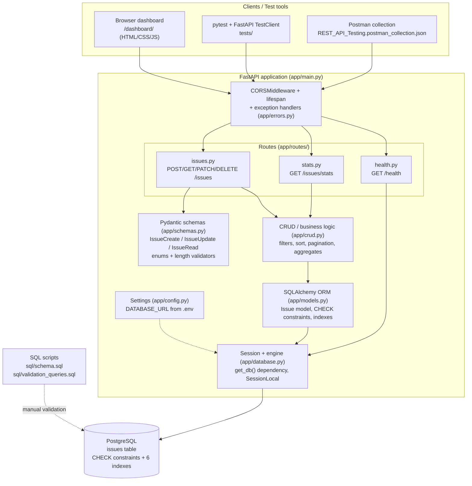

# Project Technical Report

## REST API Testing & Database Validation Platform

| Field | Value |
| --- | --- |
| Project title | REST API Testing & Database Validation Platform |
| Application | Defect-tracking REST API (`issues`) |
| Version | 1.0.0 |
| Report date | 2026-10-23 |
| Report scope | Source code, configuration, dependencies, schema, API routes, automated tests, Postman collection and SQL scripts that are **actually implemented in this repository** |
| Verification method | Every version number, path, endpoint, constraint and test result in this report was read from the source or produced by a command run in this environment |

> **Accuracy statement.** This report documents only what exists in the code. Where a capability could not be executed (PostgreSQL server not installed in the build environment), it is explicitly marked **Pending** with the exact command needed to complete it. No test result, coverage figure or validation output has been invented.

---

## Table of contents

1. [Project Overview](#1-project-overview)
2. [Technology Stack](#2-technology-stack)
3. [System Architecture](#3-system-architecture)
4. [Project Folder Structure](#4-project-folder-structure)
5. [Development Process](#5-development-process)
6. [Database Design](#6-database-design)
7. [REST API Documentation](#7-rest-api-documentation)
8. [Testing Strategy](#8-testing-strategy)
9. [Test Results and Coverage](#9-test-results-and-coverage)
10. [Security and Reliability](#10-security-and-reliability)
11. [Challenges and Solutions](#11-challenges-and-solutions)
12. [How to Run the Project](#12-how-to-run-the-project)
13. [Skills Demonstrated](#13-skills-demonstrated)
14. [Limitations and Future Improvements](#14-limitations-and-future-improvements)
15. [Interview Preparation](#15-interview-preparation)
16. [Project Summary](#16-project-summary)
17. [Appendix - Files Inspected, Commands Executed, Unverified Items](#17-appendix---files-inspected-commands-executed-unverified-items)

---

## 1. Project Overview

### 1.1 Title and purpose

**REST API Testing & Database Validation Platform** is a portfolio project: a defect-tracking REST API plus the complete QA toolchain around it (Postman collection, pytest suite with coverage, SQL validation scripts and formal test documentation).

The API lets a tester **create, retrieve, filter, update and delete software defect records** and read **aggregated statistics**. Every write is validated twice - by Pydantic at the API boundary and by `CHECK` constraints in the database - and every endpoint is documented and tested.

### 1.2 Problem statement

Testers need a realistic system under test where they can practise and demonstrate the full QA workflow: designing test cases from a specification, exercising an API through Postman, validating that what the API returned is what the database stored (through SQL, not through the API), verifying negative and boundary behaviour, and automating all of it with a regression suite. A defect tracker is the natural domain for this because it is exactly the kind of tool a QA engineer uses day to day.

### 1.3 Objectives

1. Provide a documented REST API with clear contracts and predictable error responses.
2. Prove data correctness at the **database** level, not just at the API level.
3. Demonstrate a layered test approach: functional, negative, boundary-value, data-consistency, integration and regression testing.
4. Provide API test assets: an importable Postman collection with assertions and variable chaining, plus SQL validation scripts.
5. Show safe engineering practice: environment-based configuration, no hardcoded credentials, no leaked internals in error responses, isolated test databases.

### 1.4 Intended users

| User | How they use the project |
| --- | --- |
| QA / test engineer | Runs the Postman collection and pytest suite, executes SQL validation queries, files defects using the template |
| Backend developer | Reads the FastAPI/SQLAlchemy implementation as an example of layered design |
| Interviewer / reviewer | Uses Swagger UI and the Postman collection to verify claims live; reads the test-execution report |
| Student | Uses it as a reference implementation of API + database testing |

### 1.5 How this project demonstrates software testing and QA skills

| QA skill | Evidence in this repository |
| --- | --- |
| Test design from requirements | `test-documentation/test-plan.md`, `test-cases.csv` (84 cases across 11 groups) |
| API functional testing | `tests/test_issues.py`, Postman requests 01-16 |
| Negative testing | Missing required fields, invalid enums, wrong types, unknown routes (`test_issues.py`, `test_errors.py`) |
| Boundary-value analysis | Title 2/3/200/201 characters, description 2001 characters, `page=0`, `page_size=0/100/101` |
| Data-consistency testing | SQL reads inside pytest (`SELECT ... WHERE id = :id`), `sql/validation_queries.sql` |
| Database constraint testing | `test_database_constraint_rejects_*` tests that bypass the API and insert raw SQL |
| Integration testing | `tests/integration/test_postgres_integration.py` against real PostgreSQL |
| Regression testing | Deterministic pytest suite, re-runnable on every change |
| Error-handling testing | `tests/test_errors.py` proves a DB failure returns a safe 500 with no leaked SQL |
| Defect management | `test-documentation/defect-report-template.md` (severity/priority definitions) |
| Test reporting | `test-documentation/test-execution-report.md` with real numbers and exit-criteria assessment |

---

## 2. Technology Stack

All versions below were printed by the installed environment (Python 3.12.9 virtual environment) unless noted.

| Technology | Version (verified) | Purpose in this project |
| --- | --- | --- |
| **Python** | 3.12.9 (declared requirement: 3.11+) | Implementation language for the API, tests and tooling |
| **FastAPI** | 0.161.1 | Web framework: routing, dependency injection, request parsing, automatic OpenAPI generation |
| **Starlette** | 1.9.0 | ASGI toolkit underlying FastAPI (routing/TestClient); pulled in as a FastAPI dependency |
| **Uvicorn** | 0.54.0 | ASGI server that runs the app (`uvicorn app.main:app`) |
| **PostgreSQL** | not installed here (target: 14+) | The intended deployment database; `issues` table with `TIMESTAMPTZ`, `CHECK` constraints and indexes |
| **psycopg2-binary** | 2.9.13 | PostgreSQL DBAPI driver used by SQLAlchemy (the `postgresql+psycopg2://` dialect) |
| **SQLAlchemy** | 2.1.6 | ORM + SQL toolkit: typed `Mapped` models, engine/session management, parameterised queries |
| **Pydantic** | 2.14.1 | Request validation and response serialisation (enums, length rules, custom validators) |
| **pydantic-settings** | 2.16.1 | Loads configuration from environment variables / `.env` into a typed `Settings` object |
| **python-dotenv** | in `requirements.txt` | Enables the `.env` file to be read (used through pydantic-settings) |
| **pytest** | 9.1.1 | Automated test framework |
| **pytest-cov** | 7.1.0 | Coverage measurement and reporting (`--cov=app --cov-report=term-missing`) |
| **httpx** | 0.28.1 | HTTP client used underneath FastAPI's `TestClient` |
| **Postman / Newman** | Postman desktop or Node.js + Newman | API test collection execution; Newman was used headlessly for the recorded results |
| **SQL** | PostgreSQL dialect (SQLite for tests) | Manual database validation, constraints, aggregates, `EXPLAIN ANALYZE` |
| **Git** | installed | Version control (repository initialised, `.gitignore` in place) |
| **Markdown + OpenAPI/Swagger** | - | Documentation: README, test docs, auto-generated `/docs` and `/openapi.json` |
| **venv (stdlib) + pip** | - | Virtual environment and dependency management |
| **HTML/CSS/JS** | - | Optional lightweight dashboard served at `/dashboard/` (no build step, no framework) |

**Dependency file:** `requirements.txt` pins ranges:
`fastapi>=0.110,<1.0`, `uvicorn[standard]>=0.27`, `SQLAlchemy>=2.0,<3.0`, `psycopg2-binary>=2.9.9`, `pydantic>=2.6,<3.0`, `pydantic-settings>=2.2`, `python-dotenv>=1.0`, `pytest>=8.0`, `pytest-cov>=5.0`, `httpx>=0.27`.

---

## 3. System Architecture

### 3.1 Layers

The application is a classic layered FastAPI service. Each layer has one responsibility, and the routing layer never contains SQL while the CRUD layer never raises HTTP errors ([crud.py](app/crud.py) docstring states this explicitly).

| Layer | Module | Responsibility |
| --- | --- | --- |
| Presentation | [main.py](app/main.py) | FastAPI application instance, lifespan, CORS, router registration, static mount |
| Routing | [routes/health.py](app/routes/health.py), [routes/issues.py](app/routes/issues.py), [routes/stats.py](app/routes/stats.py) | HTTP verbs, status codes, query parameters, dependency injection |
| Validation / serialisation | [schemas.py](app/schemas.py) | Pydantic models, enum + length rules, UTC normalisation |
| Business logic / data access | [crud.py](app/crud.py) | Create/read/update/delete, filtering, sorting, pagination, aggregates |
| Persistence | [models.py](app/models.py), [database.py](app/database.py) | ORM models, engine, session factory, `get_db` dependency |
| Cross-cutting | [config.py](app/config.py), [errors.py](app/errors.py) | Settings, consistent error contract, exception handlers |
| Data store | PostgreSQL | `issues` table, `CHECK` constraints, 6 indexes |

### 3.2 Architecture diagram



### 3.3 How components communicate (request flow for `POST /issues`)

1. Uvicorn receives the HTTP request and hands it to the FastAPI application.
2. `CORSMiddleware` and the registered exception handlers wrap the call ([main.py](app/main.py#L51-L59)).
3. The `issues` router matches `POST /issues`; FastAPI injects a DB session through `Depends(get_db)`.
4. Pydantic validates the body against `IssueCreate`. A failure raises `RequestValidationError`, and the handler returns `422` with a field-level `details` array.
5. `crud.create_issue()` builds an `Issue` ORM object and commits the transaction.
6. The database `CHECK` constraints act as the second line of defence; a violation surfaces as a `SQLAlchemyError` and is converted to a safe `500 database_error`.
7. The row is serialised with `IssueRead` (UTC timestamps guaranteed) and returned as `201`.

**Router ordering note:** `stats.router` is included **before** `issues.router` so that `/issues/stats` is not captured by `/issues/{issue_id}` ([main.py](app/main.py#L61-L64)). A dedicated test asserts this (`test_stats_route_is_not_shadowed_by_issue_id_route`).

---

## 4. Project Folder Structure

Actual tree of the repository (generated artefacts such as `.venv/`, `__pycache__/`, `.pytest_cache/` are omitted; they are git-ignored):

```text
rest-api-testing-db-validation/
├── app/
│   ├── routes/
│   │   ├── __init__.py              # re-exports health, issues, stats routers
│   │   ├── health.py                # GET /health
│   │   ├── issues.py                # POST/GET/PATCH/DELETE /issues
│   │   └── stats.py                 # GET /issues/stats
│   ├── static/                      # optional no-build dashboard
│   │   ├── index.html               # stats cards, create form, table + filters
│   │   ├── styles.css               # styling
│   │   └── app.js                   # fetch() client for the API
│   ├── __init__.py                  # package marker, __version__ = "1.0.0"
│   ├── config.py                    # Settings (pydantic-settings) from env/.env
│   ├── database.py                  # Base, build_engine, engine, SessionLocal, get_db
│   ├── crud.py                      # data access + business logic
│   ├── db_init.py                   # schema init CLI: python -m app.db_init
│   ├── errors.py                    # APIError, error_body, exception handlers
│   ├── main.py                      # FastAPI app, lifespan, CORS, routers, static mount
│   ├── models.py                    # Issue model + enums + CHECK constraints + indexes
│   └── schemas.py                   # Pydantic request/response models
├── postman/
│   └── REST_API_Testing.postman_collection.json   # 16 requests, 6 folders
├── sql/
│   ├── schema.sql                   # PostgreSQL DDL, constraints, indexes, updated_at trigger
│   └── validation_queries.sql       # 17 read-only validation queries
├── test-documentation/
│   ├── test-plan.md                 # scope, objectives, entry/exit criteria, risks, approach
│   ├── test-cases.csv               # 84 test cases (11 groups)
│   ├── defect-report-template.md    # template + clearly-labelled illustrative example
│   ├── database-validation.md       # end-to-end DB validation workflow + recorded results
│   └── test-execution-report.md     # actual pytest / Newman results, exit-criteria assessment
├── tests/
│   ├── integration/
│   │   └── test_postgres_integration.py   # 5 PostgreSQL tests (opt-in, skipped by default)
│   ├── conftest.py                  # fixtures: isolated in-memory SQLite + TestClient
│   ├── test_errors.py               # error contract, DB-failure 500, 404/405
│   ├── test_health.py               # health, root, OpenAPI schema, degraded DB
│   ├── test_issues.py               # CRUD, validation, boundaries, filters, SQL constraints
│   └── test_stats.py                # statistics accuracy and consistency
├── .env.example                     # placeholders only (no real credentials)
├── .gitignore                       # excludes .env, .venv, caches, coverage
├── PROJECT_TECHNICAL_REPORT.md      # this document
├── pytest.ini                       # testpaths, pythonpath, integration marker
├── requirements.txt                 # runtime + test dependencies
└── README.md                        # setup, endpoints, examples, limitations
```

### Purpose of each important file

| File | Purpose |
| --- | --- |
| `app/main.py` | Creates the `FastAPI` instance, wires the `lifespan`, CORS, exception handlers and routers, mounts the dashboard, exposes a root discovery endpoint |
| `app/config.py` | Single source of configuration. `Settings` reads `DATABASE_URL`, pool sizes, CORS origins, page sizes and `AUTO_CREATE_TABLES` from the environment; `get_settings()` is `lru_cache`d |
| `app/database.py` | `Base` (declarative base), `build_engine()` (branches for SQLite vs PostgreSQL), `engine`, `SessionLocal`, and the `get_db()` generator dependency that always closes the session and rolls back on error |
| `app/models.py` | The `Issue` ORM model, four enums, `utcnow()`, five `CHECK` constraints and six indexes |
| `app/schemas.py` | `IssueBase`, `IssueCreate`, `IssueUpdate` (all-optional with a "at least one field" validator), `IssueRead`, `IssueListResponse`, `StatsResponse`, `HealthResponse`, `ErrorDetail`, `ErrorResponse` |
| `app/crud.py` | All SQL: create, get, list (filters/sort/pagination), update, delete, stats aggregation |
| `app/errors.py` | `APIError`, `error_body()` and the four global exception handlers producing the `{"error": {...}}` contract |
| `app/db_init.py` | `init_db()` + a CLI so the schema can be created with `python -m app.db_init` |
| `app/routes/*` | Thin HTTP layer; each route maps verbs/params to `crud` calls |
| `app/static/*` | Optional dashboard; consumes the same API via `fetch()` |
| `tests/conftest.py` | Shared fixtures; the isolation guarantee lives here |
| `postman/REST_API_Testing.postman_collection.json` | 16 importable requests with `pm.test` assertions and `pm.collectionVariables` chaining |
| `sql/schema.sql` | DDL alternative to `db_init`; identical constraint/index names + an `updated_at` trigger |
| `sql/validation_queries.sql` | 17 read-only queries for stored-value, duplicate, invalid-value, stats and index checks |

---

## 5. Development Process

The project was built in the seven phases requested by the specification.

### Phase 1 - Environment inspection and scaffolding

```powershell
cd rest-api-testing-db-validation
python -m venv .venv
.\.venv\Scripts\Activate.ps1
python -m pip install --upgrade pip
pip install -r requirements.txt
```

The environment was inspected first: Python 3.12.9 and Git were present, Node.js was available (for Newman), but **PostgreSQL (`psql`) was not installed**. This shaped a key decision: the automated suite runs on isolated SQLite, PostgreSQL behaviour is covered by a separate opt-in integration suite, and all PostgreSQL-dependent results are documented as *Pending* rather than claimed.

### Phase 2 - Backend and database integration

Implementation order:

1. `app/config.py` - typed settings so nothing is hardcoded.
2. `app/database.py` - `Base`, `build_engine()` with a SQLite/PostgreSQL branch, `SessionLocal`, and the `get_db()` dependency with rollback-on-exception.
3. `app/models.py` - the `Issue` model with enums, `CHECK` constraints and indexes.
4. `app/schemas.py` - Pydantic models with `field_validator`s for trimming title/description and a `model_validator` enforcing "at least one field" on PATCH.
5. `app/errors.py` - the error contract and global handlers.

### Phase 3 - Endpoints and validation

1. `app/crud.py` - all data access, including the `SORTABLE_COLUMNS` allow-list and the deterministic `id` tie-breaker for pagination.
2. `app/routes/health.py`, `app/routes/stats.py`, `app/routes/issues.py`.
3. `app/main.py` - router registration in the correct order, CORS, exception handlers, static mount.
4. `app/db_init.py` - the schema-init CLI.

### Phase 4 - Postman collection and pytest suite

1. `tests/conftest.py` - per-test in-memory SQLite with `StaticPool`, a `client` fixture that overrides `get_db`, and a payload factory.
2. `tests/test_health.py`, `test_issues.py`, `test_stats.py`, `test_errors.py`.
3. `tests/integration/test_postgres_integration.py` - guarded by `TEST_DATABASE_URL` and a `_test` name check.
4. The Postman collection: 6 folders, 16 requests, assertions and chained variables.

### Phase 5 - SQL scripts and QA documentation

`sql/schema.sql`, `sql/validation_queries.sql`, and the five documents under `test-documentation/`.

### Phase 6 - Run, debug, fix

The suites were executed, failures diagnosed and fixed (see §9 for the real results and §11 for the fixes), until the suite passed end to end.

### Phase 7 - Verify setup and finalise the README

The server was started for real, the Postman collection was executed with Newman against the live server, and the README was written last so that every command in it had already been executed.

### Application startup

```powershell
python -m app.db_init                       # create the schema
uvicorn app.main:app --reload               # run with auto-reload
uvicorn app.main:app --host 127.0.0.1 --port 8000
```

---

## 6. Database Design

The schema is a **single table** (`issues`). There are **no foreign keys** because the domain model has no related tables in v1.0 (a deliberate scope decision, listed in §14).

### 6.1 Table `issues`

| Column | PostgreSQL type | Nullable | Default (DB) | ORM default | Notes |
| --- | --- | --- | --- | --- | --- |
| `id` | `SERIAL` / `INTEGER` | No | next sequence value | autoincrement | **Primary key** |
| `title` | `VARCHAR(200)` | No | - | - | 3-200 chars enforced by CHECK + Pydantic |
| `description` | `TEXT` | Yes | `NULL` | `None` | optional, max 2000 enforced by Pydantic |
| `severity` | `VARCHAR(20)` | No | `'Medium'` | `Medium` | enum: Low, Medium, High, Critical |
| `status` | `VARCHAR(20)` | No | `'Open'` | `Open` | enum: Open, In Progress, Closed |
| `category` | `VARCHAR(20)` | No | `'Functional'` | `Functional` | enum: Functional, UI, API, Performance, Security |
| `environment` | `VARCHAR(20)` | No | `'Web'` | `Web` | enum: Web, Android, iOS, Linux, Backend API |
| `created_at` | `TIMESTAMPTZ` (`DateTime(timezone=True)`) | No | `now()` | `utcnow()` | UTC, set once |
| `updated_at` | `TIMESTAMPTZ` | No | `now()` | `utcnow()` + `onupdate` | UTC, refreshed on every update |

### 6.2 Constraints

Defined in [models.py](app/models.py#L87-L104) (ORM) and [schema.sql](sql/schema.sql#L31-L37) (SQL) with identical names:

| Constraint | Definition |
| --- | --- |
| Primary key | `PRIMARY KEY (id)` |
| `ck_issues_title_length` | `length(title) >= 3 AND length(title) <= 200` |
| `ck_issues_severity` | `severity IN ('Low','Medium','High','Critical')` |
| `ck_issues_status` | `status IN ('Open','In Progress','Closed')` |
| `ck_issues_category` | `category IN ('Functional','UI','API','Performance','Security')` |
| `ck_issues_environment` | `environment IN ('Web','Android','iOS','Linux','Backend API')` |
| NOT NULL | on `title`, `severity`, `status`, `category`, `environment`, `created_at`, `updated_at` |

### 6.3 Indexes

| Index | Columns | Rationale |
| --- | --- | --- |
| `ix_issues_severity` | `severity` | `GET /issues?severity=` |
| `ix_issues_status` | `status` | `GET /issues?status=` |
| `ix_issues_category` | `category` | `GET /issues?category=` |
| `ix_issues_environment` | `environment` | `GET /issues?environment=` |
| `ix_issues_created_at` | `created_at` | default sort order |
| `ix_issues_status_severity` | `status, severity` | composite filter used by the UI and stats |

Existence of all six indexes is asserted in `test_expected_indexes_exist`.

### 6.4 Timestamp maintenance

- **Through the API:** `updated_at` is refreshed by SQLAlchemy's `onupdate=utcnow` **and** explicitly in `crud.update_issue()`.
- **Through raw SQL:** `sql/schema.sql` installs a `BEFORE UPDATE` trigger (`trg_issues_set_updated_at`) that sets `NEW.updated_at = now()`, so manual SQL edits also keep the column accurate.

### 6.5 Data lifecycle (CRUD)

| Operation | Mechanism | SQL shape (parameterised) |
| --- | --- | --- |
| Create | `crud.create_issue()` → `db.add()` + `db.commit()` + `db.refresh()` | `INSERT INTO issues (title, ...) VALUES (:title, ...)` |
| Read one | `crud.get_issue()` → `db.get(Issue, id)` | primary-key lookup |
| Read many | `crud.list_issues()` | `SELECT ... WHERE <filters> ORDER BY <col>, id DESC OFFSET :n LIMIT :m` |
| Update | `crud.update_issue()` → setattr + commit | `UPDATE issues SET ... WHERE id = :id` |
| Delete | `crud.delete_issue()` → `db.delete()` + commit | `DELETE FROM issues WHERE id = :id` |
| Aggregate | `crud.get_stats()` | two `SELECT col, COUNT(id) ... GROUP BY col` plus a total `COUNT(*)` |

### 6.6 SQL examples that work with this schema

```sql
-- Inspect a stored record (compare field by field with the API response)
SELECT id, title, severity, status, category, environment,
       created_at AT TIME ZONE 'UTC' AS created_at_utc,
       updated_at AT TIME ZONE 'UTC' AS updated_at_utc
FROM issues
WHERE id = 1;

-- Aggregates that must match GET /issues/stats
SELECT status, COUNT(*) FROM issues GROUP BY status ORDER BY status;
SELECT severity, COUNT(*) FROM issues GROUP BY severity ORDER BY severity;

-- Constraints are enforced by the database, not only by the API
INSERT INTO issues (title, severity, status, category, environment)
VALUES ('Bad severity', 'Blocker', 'Open', 'API', 'Web');
-- ERROR: new row for relation "issues" violates check constraint "ck_issues_severity"

-- Invalid data must never exist (0 rows expected)
SELECT id, severity FROM issues
WHERE severity NOT IN ('Low','Medium','High','Critical')
   OR status   NOT IN ('Open','In Progress','Closed')
   OR category NOT IN ('Functional','UI','API','Performance','Security')
   OR environment NOT IN ('Web','Android','iOS','Linux','Backend API');

-- updated_at must never precede created_at (0 rows expected)
SELECT id, created_at, updated_at FROM issues WHERE updated_at < created_at;
```

---

## 7. REST API Documentation

Base URL locally: `http://127.0.0.1:8000`. The OpenAPI schema is served at `/openapi.json`, Swagger UI at `/docs`, ReDoc at `/redoc`.

### 7.1 Endpoint summary

| Method | Path | Success | Failure cases | Source |
| --- | --- | --- | --- | --- |
| GET | `/health` | 200 | 503 (DB unreachable) | `routes/health.py` |
| POST | `/issues` | 201 | 422, 500 | `routes/issues.py` |
| GET | `/issues` | 200 | 422 (bad query params) | `routes/issues.py` |
| GET | `/issues/{id}` | 200 | 404, 422 (non-integer id) | `routes/issues.py` |
| PATCH | `/issues/{id}` | 200 | 404, 422 | `routes/issues.py` |
| DELETE | `/issues/{id}` | 204 | 404 | `routes/issues.py` |
| GET | `/issues/stats` | 200 | - | `routes/stats.py` |
| GET | `/` | 200 | - | `main.py` (discovery, `include_in_schema=False`) |

### 7.2 `GET /health`

Health check and database connectivity. Executes `SELECT 1`.

- **Response 200:** `{"status":"ok","database":"connected","dialect":"sqlite|postgresql","version":"1.0.0"}`
- **Response 503:** `{"status":"degraded","database":"unavailable","dialect":null,"version":"1.0.0"}`

```json
{ "status": "ok", "database": "connected", "dialect": "postgresql", "version": "1.0.0" }
```

### 7.3 `POST /issues` - create a defect

- **Body:** `IssueCreate` (see field table below). `Content-Type: application/json`.
- **201:** the created record with the generated `id`.
- **422:** `error.type = "validation_error"` with a `details` array.

Request:

```json
{
  "title": "Login button unresponsive on Android 13",
  "description": "Tapping the Log in button does not submit the form.",
  "severity": "High",
  "status": "Open",
  "category": "Functional",
  "environment": "Android"
}
```

Response `201`:

```json
{
  "id": 1,
  "title": "Login button unresponsive on Android 13",
  "description": "Tapping the Log in button does not submit the form.",
  "severity": "High",
  "status": "Open",
  "category": "Functional",
  "environment": "Android",
  "created_at": "2026-10-23T04:25:30.666261Z",
  "updated_at": "2026-10-23T04:25:30.666261Z"
}
```

### 7.4 `GET /issues` - list, filter, sort, paginate

| Parameter | Type | Default | Notes |
| --- | --- | --- | --- |
| `severity` | enum | - | exact match |
| `status` | enum | - | exact match (query alias `status`, internal name `status_filter`) |
| `category` | enum | - | exact match |
| `environment` | enum | - | exact match |
| `search` | string (≤200) | - | case-insensitive `ILIKE` on `title` OR `description` |
| `page` | int ≥ 1 | 1 | page number |
| `page_size` | int 1-100 | 20 (`default_page_size`) | 101 → 422 |
| `sort_by` | Literal | `created_at` | `id`, `title`, `severity`, `status`, `category`, `environment`, `created_at`, `updated_at` |
| `order` | `asc`/`desc` | `desc` | sort direction |

Response `200` (`IssueListResponse`):

```json
{
  "total": 1,
  "page": 1,
  "page_size": 20,
  "pages": 1,
  "items": [
    {
      "id": 4,
      "title": "Severity sweep - Critical defect example",
      "description": "Created by the Postman severity sweep.",
      "severity": "Critical",
      "status": "Open",
      "category": "API",
      "environment": "Backend API",
      "created_at": "2026-10-23T05:02:11.128004Z",
      "updated_at": "2026-10-23T05:02:11.128004Z"
    }
  ]
}
```

Pagination is deterministic: the query orders by the requested column and then by `id DESC` as a tie-breaker, so a record can never appear on two pages or be skipped when values are equal.

### 7.5 `GET /issues/{id}`

- **200:** one `IssueRead`.
- **404:** `{"error":{"type":"not_found","message":"Issue with id 1 was not found"}}`.
- **422:** non-integer id (for example `/issues/not-a-number`).

### 7.6 `PATCH /issues/{id}` - partial update

- **Body:** `IssueUpdate` - every field optional, but **at least one field is required** (`_require_at_least_one_field`). An empty `{}` body returns 422.
- **200:** the updated record; `created_at` unchanged, `updated_at` newer.
- **404:** unknown id. **422:** invalid enum, title shorter than 3, or empty body.

```json
{ "status": "In Progress" }
```

```json
{
  "id": 1,
  "title": "Login button unresponsive on Android 13",
  "severity": "High",
  "status": "In Progress",
  "created_at": "2026-10-23T04:25:30.666261Z",
  "updated_at": "2026-10-23T04:25:30.711037Z"
}
```

### 7.7 `DELETE /issues/{id}`

- **204:** empty body (`response.content == b""`, asserted in `test_delete_issue_returns_204_with_empty_body`).
- **404:** unknown id (and a second delete of the same id).

### 7.8 `GET /issues/stats`

Counts grouped by status and by severity, always including **zero buckets**.

```json
{
  "total": 1,
  "by_status": { "Open": 0, "In Progress": 1, "Closed": 0 },
  "by_severity": { "Low": 0, "Medium": 0, "High": 1, "Critical": 0 }
}
```

### 7.9 Field rules (request)

| Field | Type | Rules |
| --- | --- | --- |
| `title` | string | required; 3-200 chars after trimming; `"  "` and `"ab"` rejected |
| `description` | string / null | optional; max 2000; empty string normalised to `null` |
| `severity` | enum | required; `Low`, `Medium`, `High`, `Critical` (`low`, `Blocker`, `""` rejected) |
| `status` | enum | required; `Open`, `In Progress`, `Closed` (`open`, `Reopened` rejected) |
| `category` | enum | required; `Functional`, `UI`, `API`, `Performance`, `Security` |
| `environment` | enum | required; `Web`, `Android`, `iOS`, `Linux`, `Backend API` |
| `id`, `created_at`, `updated_at` | - | server generated, read-only |

### 7.10 Error contract

Every failure - regardless of cause - returns:

```json
{
  "error": {
    "type": "validation_error",
    "message": "Request validation failed",
    "details": [
      { "field": "severity", "message": "Input should be 'Low', 'Medium', 'High' or 'Critical'", "type": "enum" }
    ]
  }
}
```

| Status | `error.type` | Source handler |
| --- | --- | --- |
| 404 | `not_found` (app) / `http_error` (unknown route) | `APIError`, `StarletteHTTPException` |
| 405 | `http_error` | `StarletteHTTPException` |
| 422 | `validation_error` | `RequestValidationError` |
| 500 | `database_error` | `SQLAlchemyError` |
| 500 | `internal_error` | generic `Exception` fallback |
| 503 | - | `/health` (plain payload, not the error contract) |

Stack traces, SQL text and credentials are never returned; they are logged server-side only ([errors.py](app/errors.py#L88-L105)).

---

## 8. Testing Strategy

### 8.1 The five testing disciplines as applied here

| Discipline | What it means | How it is applied in this project |
| --- | --- | --- |
| **Manual testing** | A human explores the running system | Swagger UI "Try it out", the `/dashboard/` UI, and manual `psql` inspection |
| **API testing** | Black-box testing of HTTP contracts | The Postman collection (16 requests, 69 assertions) executed in Postman or Newman |
| **Database validation** | Verifying stored state independently of the API | `sql/validation_queries.sql` (17 queries) + SQL reads inside pytest |
| **Integration testing** | Verifying the real driver/server behaviour | `tests/integration/test_postgres_integration.py` against real PostgreSQL |
| **Automated testing** | Repeatable, deterministic regression suite | pytest + FastAPI `TestClient`, 121 collected tests |

The key principle: **API testing alone is not sufficient.** A 201 response only proves the API *said* it stored the data. The SQL layer proves the row actually exists with the right values.

### 8.2 The pytest test files and what they cover

| File | Tests | Coverage focus |
| --- | --- | --- |
| `tests/conftest.py` | - | Fixtures only (no tests). Defines `db_engine`, `db_session`, `client`, `valid_issue_payload`, `create_issue` |
| `tests/test_health.py` | 4 | Health 200 with dialect, root discovery links, OpenAPI schema contains all endpoints, health 503 when DB is down |
| `tests/test_issues.py` | 103 | CRUD, every enum value, missing/invalid fields, title boundaries, filters, sorting, pagination, SQL constraints, indexes |
| `tests/test_stats.py` | 5 | Zero buckets on empty DB, accuracy, consistency after update, after delete, route not shadowed |
| `tests/test_errors.py` | 3 | Safe 500 on DB failure, consistent 404, consistent 405 |
| `tests/integration/test_postgres_integration.py` | 5 | PostgreSQL dialect reporting, UTC `TIMESTAMPTZ`, real CHECK violation via raw SQL, `updated_at` after PATCH, delete-then-select |

**Total collected: 121** (116 run + 5 skipped by default).

### 8.3 Test categories in the suite

| Category | Representative tests |
| --- | --- |
| **Positive** | `test_create_issue_returns_201_with_generated_id`, `test_get_issue_by_id`, `test_patch_issue_status_only`, `test_delete_issue_returns_204_with_empty_body` |
| **Negative** | `test_create_issue_with_missing_required_field_returns_422` (parametrised over 5 fields), `test_create_issue_with_invalid_severity_returns_422`, `test_get_nonexistent_issue_returns_404`, `test_patch_issue_with_empty_body_returns_422` |
| **Boundary value** | title `"ab"` (2) rejected / `"abc"` (3) accepted / `"T"*200` accepted / `"T"*201` rejected; description 2001 rejected; `page=0`, `page_size=0`, `page_size=101` rejected; `page_size=1000` rejected in Postman |
| **Validation** | All four enums criticised with wrong casing and unknown values; wrong data type (`title: 12345`); trimming of `"   Padded title   "` |
| **Error handling** | `test_database_failure_returns_safe_500_response` asserts the body contains none of `traceback`, `sqlalchemy`, `select `, `insert into`, `password`; `test_unknown_route_returns_consistent_404`; `test_method_not_allowed_returns_consistent_405` |
| **Database checks** | `test_create_issue_persists_the_row_in_the_database`, `test_patch_issue_persists_change_to_the_database`, `test_delete_removes_the_row_from_the_database`, `test_expected_indexes_exist`, `test_database_constraint_rejects_invalid_severity` / `_short_title` / `_null_required_column` |
| **Data consistency** | `test_failed_patch_does_not_change_the_record`, `test_model_never_stores_invalid_enum_values`, `test_list_issues_pagination_splits_records_across_pages` (asserts no duplicate ids across pages) |

### 8.4 Test isolation (why a developer's database is safe)

The isolation guarantee is structural, not conventional:

1. Every test gets a **fresh in-memory SQLite database** (`sqlite+pysqlite:///:memory:`) created and dropped by the `db_engine` fixture.
2. `StaticPool` keeps one shared connection so the schema survives across the session.
3. The `client` fixture overrides `app.dependency_overrides[get_db]`, so the API talks to the test session.
4. Before yielding, the fixture **asserts** `db_session.get_bind().dialect.name == "sqlite"` - if a test ever pointed at a real database, the suite would fail immediately.
5. The integration suite refuses to run unless the database name ends with `_test` and truncates with `TRUNCATE TABLE issues RESTART IDENTITY` between tests.

### 8.5 Importing and executing the Postman collection

1. Start the API: `uvicorn app.main:app`.
2. Postman → **Collections** → **Import** → select `postman/REST_API_Testing.postman_collection.json`.
3. Collection **Variables** tab → confirm `baseUrl` = `http://127.0.0.1:8000`.
4. Click **Run** (Collection Runner) with the default order.
5. Review the **Test Results** tab.

Collection variables: `baseUrl`, `issueId`, `severityIssueIds`, `deletedIssueId`. Request `02` captures the created `id` into `issueId`; requests `10`-`12` reuse it; request `12` moves it to `deletedIssueId`; request `13` proves it is gone. **No request depends on a hardcoded database id** - requests `08` and `12` create their own defect in a pre-request script if `issueId` is empty, so they also work standalone. Request `09` deliberately uses `999999`, which is an unused id, not a stored record.

Headless execution:

```powershell
npm install -g newman
newman run postman/REST_API_Testing.postman_collection.json
```

### 8.6 How SQL is used to verify API results against database records

The same create/read/update/delete flow is validated at three levels:

| Level | Where | Example |
| --- | --- | --- |
| In-test SQL | pytest `db_session.execute(text("SELECT ... WHERE id = :id"), {"id": ...})` | Asserts stored `severity`/`status` equal what was submitted |
| Standalone SQL script | `sql/validation_queries.sql` queries 1-3, 9-10, 13-14 | Compare a `psql` row with the Postman response; compare status/severity counts with `/issues/stats` |
| Integrity SQL | `sql/validation_queries.sql` queries 4-8, 16 | Duplicate detection, invalid-value detection, `updated_at < created_at`, constraint inventory |

The step-by-step workflow (submit → capture id → GET → SQL check → update → SQL check → delete → verify) is documented in `test-documentation/database-validation.md`.

---

## 9. Test Results and Coverage

**All figures below were produced by actual command runs in this environment on 2026-10-23. Nothing is estimated.**

### 9.1 Commands executed

```powershell
pytest -v
pytest --cov=app --cov-report=term-missing
newman run postman/REST_API_Testing.postman_collection.json
```

### 9.2 pytest result (actual)

```text
121 passed, 5 skipped, 1 warning in ~4-6s
```

| Metric | Value |
| --- | --- |
| Tests collected | 121 |
| Executed | 121 |
| **Passed** | **121** |
| Failed | 0 |
| Errors | 0 |
| Skipped | 5 (PostgreSQL integration tests - `TEST_DATABASE_URL` not configured) |
| Warnings | 1 (upstream Starlette deprecation notice about the `httpx` TestClient shim; not project code) |

### 9.3 Coverage result (actual, pytest-cov)

```text
Name                     Stmts   Miss  Cover   Missing
------------------------------------------------------
app\__init__.py              1      0   100%
app\config.py               22      0   100%
app\crud.py                 61      1    98%   99
app\database.py             27      8    70%   31, 45-52
app\db_init.py              15     15     0%   11-34
app\errors.py               41      2    95%   109-110
app\main.py                 33      3    91%   33-35
app\models.py               48      0   100%
app\routes\__init__.py       2      0   100%
app\routes\health.py        18      0   100%
app\routes\issues.py        34      0   100%
app\routes\stats.py          9      0   100%
app\schemas.py              99      5    95%   46, 78, 94-95, 125
------------------------------------------------------
TOTAL                      410     34    92%
```

Uncovered lines are all intentional: `db_init.py` is a CLI wrapper run manually; `database.py` lines 45-52 are the PostgreSQL pool branch plus the module-level engine creation; `main.py` 33-35 is the `AUTO_CREATE_TABLES` startup branch; `schemas.py` contains defensive `None` branches; `errors.py` 109-110 is the deliberately hard-to-trigger generic fallback.

### 9.4 Postman collection result (actual, Newman)

Executed against the live server (`uvicorn app.main:app` on `http://127.0.0.1:8000`):

| Metric | Value |
| --- | --- |
| Iterations | 1 |
| Requests executed | 21 (16 collection requests + 5 chained `pm.sendRequest` calls) |
| Requests failed | 0 |
| Test scripts executed | 16 |
| Test scripts failed | 0 |
| Pre-request scripts executed | 19 |
| Pre-request scripts failed | 0 |
| Assertions executed | 69 |
| Assertions failed | 0 |
| Total run duration | 1387 ms |

Per-request outcomes: health `200`; create `201`; severity sweep `201` ×4; missing-fields `422`; invalid-severity `422`; short-title `422`; list `200`; get-by-id `200`; nonexistent `404`; patch `200` (+ follow-up GET `200`); invalid-patch `422` (+ follow-up GET `200`); delete `204`; get-deleted `404`; filter `200`; pagination `200`; stats `200`.

### 9.5 Live server verification (actual)

| Step | Observed result | Status |
| --- | --- | --- |
| `python -m app.db_init` | `Tables available: issues` | Pass |
| `GET /health` | `200 {"status":"ok","database":"connected","dialect":"sqlite","version":"1.0.0"}` | Pass |
| `POST /issues` | `201`, `id=1`, `created_at=2026-10-23T04:25:30.666261Z` | Pass |
| `PATCH /issues/1 {"status":"In Progress"}` | `200`, `updated_at=2026-10-23T04:25:30.711037Z` (newer) | Pass |
| `GET /issues/stats` | `{"total":1,"by_status":{"Open":0,"In Progress":1,"Closed":0},...}` | Pass |
| `DELETE /issues/1` | `204`, empty body | Pass |
| `GET /issues/1` after delete | `404`, `error.type = "not_found"` | Pass |
| `GET /docs`, `/openapi.json`, `/dashboard/` | `200` | Pass |

The throwaway SQLite file used for this verification was deleted afterwards.

### 9.6 Results NOT executed here

| Item | Status | Reason | Command to run it |
| --- | --- | --- | --- |
| 5 PostgreSQL integration tests | **Not executed / Skipped** | No PostgreSQL server installed in this environment (`psql` unavailable) | `$env:TEST_DATABASE_URL="postgresql+psycopg2://postgres:<pw>@localhost:5432/defect_tracker_test"` then `pytest tests/integration -v -m integration` |
| PostgreSQL SQL validation queries | **Not executed / Pending** | Same reason | `psql -U postgres -d defect_tracker -f sql/validation_queries.sql` |
| Load / performance / security testing | **Not performed** | Out of scope for v1.0 | - |

These items are marked *Pending* (never claimed as passing) in `test-documentation/database-validation.md` §3.2 and `test-documentation/test-execution-report.md` §7.

---

## 10. Security and Reliability

### 10.1 Implemented protections

| Area | Implementation | Evidence |
| --- | --- | --- |
| **Input validation** | Pydantic v2: `Field(min_length=3, max_length=200)`, enum types, `max_length=2000` on description, `field_validator` trimming, `model_validator` requiring ≥1 field on PATCH | [schemas.py](app/schemas.py) |
| **Query-parameter validation** | `page ≥ 1`, `1 ≤ page_size ≤ 100`, `search ≤ 200`, `Literal` types for `sort_by`/`order` | [routes/issues.py](app/routes/issues.py#L48-L70) |
| **SQL injection protection** | All access goes through the SQLAlchemy ORM / Core `select()` with bound parameters. The only raw SQL is `text("SELECT 1")` in the health check (no user input) | `crud.py`, `routes/health.py` |
| **Database constraints** | Five `CHECK` constraints + NOT NULL, so integrity holds even if the API layer is bypassed | [models.py](app/models.py#L87-L104), [schema.sql](sql/schema.sql) |
| **No credential leakage** | `errors.py` returns only `type`/`message`; the DB handler logs `exc.__class__.__name__` only. `db_init` logs `engine.url.render_as_string(hide_password=True)`. A test asserts the 500 body contains no `password`/`sqlalchemy`/`traceback` | [test_errors.py](tests/test_errors.py#L38-L40) |
| **No stack traces to clients** | Global handlers for `SQLAlchemyError` and `Exception` return generic messages; details go to the log | [errors.py](app/errors.py#L88-L105) |
| **Secret management** | Configuration only via env vars / `.env`; `.env.example` contains placeholders only; `.env` is git-ignored | [.env.example](.env.example), [.gitignore](.gitignore#L1-L4) |
| **Session/transaction hygiene** | `get_db()` rolls back on exception and always closes the session; `pool_pre_ping=True` avoids stale connections | [database.py](app/database.py#L43-L52) |
| **CORS** | Configurable allow-list via `CORS_ORIGINS`; `allow_credentials=False` | [main.py](app/main.py#L51-L57) |
| **No real personal data** | All sample data is synthetic (defect descriptions about UI buttons, forms, etc.) | - |
| **Safe failure** | Database outage → `503` on `/health` and `500 database_error` on write paths, never a crash | `test_health_returns_503_when_database_is_unavailable`, `test_database_failure_returns_safe_500_response` |

### 10.2 Recommended but NOT implemented

| Improvement | Why it matters |
| --- | --- |
| Authentication / authorisation (JWT or API key) | All endpoints are currently open; fine for local use only |
| Rate limiting | Endpoints can be called without limit |
| Request/response audit logging | No record of who changed what |
| HTTPS / TLS termination | Not configured (assumed to sit behind a reverse proxy) |
| Security headers (CSP, HSTS) | Not added |
| Secrets manager integration | Uses `.env` files rather than a vault |
| Input sanitisation for the dashboard | `escapeHtml()` exists in `app.js`, but the dashboard is a convenience UI, not a hardened surface |
| Dependency vulnerability scanning | No `pip-audit`/Dependabot in CI |

**No compliance certification or production security audit is claimed.** This is a portfolio/learning project.

---

## 11. Challenges and Solutions

### 11.1 Challenges evidenced in the code and documentation

| # | Challenge | Evidence in the repository | Solution implemented |
| --- | --- | --- | --- |
| 1 | **No PostgreSQL server available in the build environment** | `test-execution-report.md` §7, `database-validation.md` §3.2 | Kept PostgreSQL-specific tests in a separate, auto-skipping integration file; documented PostgreSQL steps as *Pending* instead of faking results; used SQLite for the API suite |
| 2 | **FastAPI deprecated `@app.on_event("startup")`** | `main.py` uses an `@asynccontextmanager` lifespan instead | Refactored to `lifespan(_: FastAPI)` passed to `FastAPI(lifespan=lifespan)` |
| 3 | **`/issues/stats` would be captured by `/issues/{issue_id}`** | Comment in `main.py` lines 61-64 and `stats.py` lines 11-12 | Registered `stats.router` before `issues.router`; added `test_stats_route_is_not_shadowed_by_issue_id_route` to lock the behaviour |
| 4 | **SQLite returns naive datetimes, PostgreSQL returns aware ones** | `schemas.py` `_ensure_utc` validator; `test_create_issue_returns_201_with_generated_id` asserts a UTC suffix | Normalised every timestamp to UTC on serialisation regardless of driver |
| 5 | **Nondeterministic pagination when sort values tie** | `crud.py` line 91 | Appended `Issue.id.desc()` as a tie-breaker; `test_list_issues_pagination_splits_records_across_pages` asserts no record is repeated |
| 6 | **Tests must never touch a developer's real database** | `conftest.py` `client` fixture assertion; integration `_test` guard | Per-test in-memory SQLite + dependency override + a hard dialect assertion |
| 7 | **PowerShell 5.1 could not parse a 204 No Content response during manual verification** | `test-execution-report.md` §1 (PowerShell 5.1 note) | Re-verified with an inline Python `httpx` script, which confirmed `204` and the empty body |
| 8 | **Ensuring error responses never leak internals** | `test_errors.py` scans the body for five leak markers | Centralised handlers that log detail server-side only |
| 9 | **Filtering must accept the enum *value* (e.g. "In Progress") while the query alias differs** | `routes/issues.py` uses `status_filter` with `Query(alias="status")` | Alias keeps the public API as `?status=` while the Python variable avoids shadowing |

### 11.2 Potential challenges (anticipated, not necessarily encountered)

These are idiomatic difficulties for this kind of stack and are marked as **potential** because the code does not record them as problems that occurred:

- Connection-pool exhaustion under concurrent load (mitigated by `DB_POOL_SIZE`/`DB_MAX_OVERFLOW`).
- Cross-dialect differences in constraint-error wording (mitigated by testing constraints at the ORM level and covering PostgreSQL separately).
- `updated_at` drifting when rows are edited outside the API (mitigated by the PostgreSQL trigger in `schema.sql`).
- Text search scaling poorly because it uses `ILIKE` (documented limitation; see §14).

---

## 12. How to Run the Project

### 12.1 Prerequisites

| Requirement | Notes |
| --- | --- |
| Python 3.11+ | verified on 3.12.9 |
| pip | bundled with Python |
| PostgreSQL 14+ | required to run against the real database (optional: the API runs on SQLite too) |
| Postman desktop **or** Node.js + Newman | to run the collection |
| Git | optional |

### 12.2 Windows (PowerShell)

```powershell
cd rest-api-testing-db-validation

# 1. Virtual environment
python -m venv .venv
.\.venv\Scripts\Activate.ps1
# If activation is blocked by execution policy:
#   Set-ExecutionPolicy -Scope Process -ExecutionPolicy Bypass ; .\.venv\Scripts\Activate.ps1
#   or call the interpreter directly: .\.venv\Scripts\python.exe -m pytest

# 2. Dependencies
python -m pip install --upgrade pip
pip install -r requirements.txt

# 3. Environment file
copy .env.example .env
#   then edit .env and set DATABASE_URL

# 4. Database (choose one)
python -m app.db_init
#   or: psql -U postgres -d defect_tracker -f sql\schema.sql

# 5. Run the API
uvicorn app.main:app --reload
#   or: uvicorn app.main:app --host 127.0.0.1 --port 8000
```

### 12.3 Linux / macOS (where supported)

```bash
cd rest-api-testing-db-validation
python3 -m venv .venv
source .venv/bin/activate
python -m pip install --upgrade pip
pip install -r requirements.txt
cp .env.example .env            # then edit DATABASE_URL
python -m app.db_init
uvicorn app.main:app --host 127.0.0.1 --port 8000
```

### 12.4 PostgreSQL setup

```powershell
# after installing PostgreSQL and adding its bin folder to PATH
psql --version
psql -U postgres
```

```sql
CREATE DATABASE defect_tracker WITH ENCODING 'UTF8';
CREATE DATABASE defect_tracker_test WITH ENCODING 'UTF8';   -- used by the integration tests
\q
```

`DATABASE_URL` format: `postgresql+psycopg2://<user>:<password>@<host>:<port>/<database>`.

| Database | Used by | Purpose |
| --- | --- | --- |
| `defect_tracker` | the application | real defect data |
| `defect_tracker_test` | `tests/integration` | dropped/recreated by the integration tests |

### 12.5 Endpoints after startup

| URL | Purpose |
| --- | --- |
| http://127.0.0.1:8000/ | discovery document |
| http://127.0.0.1:8000/health | health check |
| http://127.0.0.1:8000/docs | Swagger UI |
| http://127.0.0.1:8000/redoc | ReDoc |
| http://127.0.0.1:8000/openapi.json | OpenAPI schema |
| http://127.0.0.1:8000/dashboard/ | optional dashboard |

### 12.6 Run the tests

```powershell
pytest -v
pytest --cov=app --cov-report=term-missing
pytest --cov=app --cov-report=html          # -> htmlcov/index.html
pytest tests/integration -v -m integration  # PostgreSQL integration (needs TEST_DATABASE_URL)
```

### 12.7 Common errors and troubleshooting

| Symptom | Cause | Fix |
| --- | --- | --- |
| `ModuleNotFoundError: No module named 'sqlalchemy'` | The virtual environment is not activated | Run `.\.venv\Scripts\Activate.ps1`, or use `.\.venv\Scripts\python.exe -m pytest` |
| `Activate.ps1 cannot be loaded because running scripts is disabled` | PowerShell execution policy | `Set-ExecutionPolicy -Scope Process -ExecutionPolicy Bypass` |
| `SELECT 1` / connection refused, `/health` returns `503` | PostgreSQL is not running or `DATABASE_URL` is wrong | Start the service; verify the URL; test with `psql -U postgres` |
| `500 database_error` on `POST /issues` | Table `issues` does not exist yet | `python -m app.db_init` or `psql -f sql/schema.sql` |
| `psql: command not found` | PostgreSQL `bin` not on `PATH` | Add e.g. `C:\Program Files\PostgreSQL\16\bin` |
| `422` on a request that "looks" correct | Enum value casing (must be exactly `In Progress`) or title < 3 chars | Check the error `details` array - it names the offending field |
| Integration tests all skip | `TEST_DATABASE_URL` not set | Set it to a `*_test` database |
| Newman: `baseUrl` errors | Server not running or wrong port | Start uvicorn and confirm the collection variable |
| `StarletteDeprecationWarning: Using httpx with starlette.testclient is deprecated` | Upstream FastAPI/Starlette notice | Informational; not a project defect |

---

## 13. Skills Demonstrated

Only skills directly supported by the implementation are listed.

**Backend development**
- Designing a layered FastAPI application (routers → schemas → CRUD → ORM).
- FastAPI dependency injection (`Depends(get_db)`), lifespan context manager, CORS.
- HTTP semantics: correct use of 200/201/204/404/422/500/503.
- Pydantic v2 validation (enums, `field_validator`, `model_validator`, `ConfigDict(from_attributes=True)`).
- Centralised exception handling with a consistent error contract.

**Database management**
- SQLAlchemy 2.x typed ORM (`DeclarativeBase`, `Mapped`, `mapped_column`).
- Schema design: primary key, NOT NULL, five `CHECK` constraints, six indexes, `TIMESTAMPTZ`.
- Engine/session management, connection pooling, `pool_pre_ping`, transaction rollback.
- Multi-dialect support (PostgreSQL in the deployment target, SQLite in tests).
- Writing SQL DDL (`schema.sql`) and read-only validation queries, plus a `plpgsql` trigger.

**API testing**
- Building an importable Postman collection with assertions on status codes, content types, field presence and error contracts.
- Variable chaining (`pm.sendRequest` + collection variables) instead of hardcoded ids.
- Headless execution with Newman.

**Automation testing**
- Structuring a pytest suite with fixtures and per-test isolation.
- Parametrised tests covering all enum values and boundary conditions.
- Coverage measurement with pytest-cov and justifying uncovered lines.
- Separating fast API tests from opt-in integration tests via markers and skip guards.

**Debugging**
- Diagnosing a deprecated FastAPI API and refactoring to `lifespan`.
- Diagnosing route-shadowing between `/issues/{id}` and `/issues/stats`.
- Working around a PowerShell 5.1 inability to parse a 204 response by verifying with `httpx`.

**Documentation**
- Writing a test plan, test cases CSV, defect report template, database validation workflow and test execution report.
- Writing a full README and using OpenAPI/Swagger for interactive docs.

**Version control**
- Initialising a Git repository, writing a `.gitignore` that excludes secrets, virtual environments and caches, and verifying that `.env` and `.venv` are ignored.

---

## 14. Limitations and Future Improvements

### 14.1 Limitations (current, honest scope)

1. **No authentication or authorisation** - every endpoint is open; local development only.
2. **PostgreSQL-specific verification is scripted but was not executed here** - no PostgreSQL server was available; the integration tests skip automatically and the SQL validation results are *Pending*.
3. **No migration framework** - no Alembic history; schema changes are not versioned.
4. **The automated suite runs on SQLite**, so PostgreSQL-only behaviour (server-side `timestamptz` offsets, exact constraint error text) is covered only by the opt-in integration suite.
5. **No soft delete or audit trail** - deletes are physical and untracked.
6. **`updated_at` is application-maintained** (plus the optional PostgreSQL trigger); naive direct SQL that skips the trigger will not refresh it.
7. **Text search uses `ILIKE`**, not full-text search; it will not scale to very large tables.
8. **No rate limiting, caching or background jobs.**
9. **No load, stress or security testing**, and no compliance certification is claimed.
10. **The dashboard is a convenience UI**, not a tested product surface.
11. **Single-table model** - no relationships/foreign keys (no `users`, `projects` or `attachments`).
12. **Structured logging** - plain `logging` output, no correlation ids.

### 14.2 Future improvements

1. Add Alembic migrations and extend the existing GitHub Actions workflow (`.github/workflows/tests.yml`, which already runs `pytest` on every push and pull request) with a coverage gate and a Newman step.
2. Add authentication (JWT or API key) with role-based permissions (tester vs admin).
3. Add soft delete, an audit/history table, and `assignee`, `reporter`, `fixed_in_version` fields.
4. Use PostgreSQL full-text search (`tsvector`) or trigram indexes for `search`.
5. Add contract testing (schemathesis / OpenAPI fuzzing) and load testing (k6 or Locust).
6. Enrich statistics: trends over time, per category/environment, mean age of open defects.
7. Containerise with Docker Compose and add structured JSON logs with correlation ids.
8. Add dependency vulnerability scanning (`pip-audit`, Dependabot).

---

## 15. Interview Preparation

15 questions and answers, all grounded in this implementation.

**Q1. Why is the project split into `routes`, `schemas`, `crud` and `models` instead of putting everything in one file?**
Each layer has one responsibility. Routes handle HTTP (verbs, status codes, query params); schemas handle validation/serialisation; `crud.py` contains all database access; `models.py` defines the schema. The `crud.py` docstring records a deliberate rule: CRUD functions never raise HTTP errors, which keeps them unit-testable and keeps the routing layer thin. This also means the same CRUD functions could be reused by a CLI or a background job.

**Q2. What is the difference between PUT and PATCH, and which does this API use?**
PUT replaces the whole resource; PATCH applies a partial update. `PATCH /issues/{id}` uses `IssueUpdate`, where every field is optional and `model_dump(exclude_unset=True)` applies only the fields the client actually sent. A `model_validator` rejects an empty body with 422, so a no-op update cannot silently succeed.

**Q3. Walk me through what happens when a client sends `POST /issues` with `"severity": "Blocker"`.**
FastAPI routes it to `create_issue`; Pydantic tries to coerce `severity` into the `Severity` enum and fails; FastAPI raises `RequestValidationError`; the handler in `errors.py` returns `422` with `error.type = "validation_error"` and a `details` array naming `severity`. No row is written - `test_model_never_stores_invalid_enum_values` asserts the table stays empty.

**Q4. Your API returns several different status codes. Justify each.**
`201` for a created resource (POST), `200` for a successful read/update, `204` for a successful delete with no body, `404` when the id does not exist, `422` for a semantically invalid request body or query parameters, `500 database_error` for a database failure, and `503` from `/health` when the database is unreachable.

**Q5. Why validate twice - Pydantic *and* database constraints?**
Pydantic protects the API boundary and produces friendly 422 errors, but it can be bypassed (a script, `psql`, or a future service writing to the same table). The `CHECK` constraints guarantee integrity at the storage layer regardless of who writes. `test_database_constraint_rejects_invalid_severity` proves the constraint fires when the API is bypassed entirely.

**Q6. How do you guarantee that automated tests never modify a developer's real database?**
Three mechanisms: (1) every test builds a fresh in-memory SQLite engine (`sqlite+pysqlite:///:memory:` with `StaticPool`) and drops it afterwards; (2) the `client` fixture overrides `app.dependency_overrides[get_db]` to point at that session; (3) the fixture asserts `db_session.get_bind().dialect.name == "sqlite"` before the test runs, so pointing at a real database fails fast. The PostgreSQL integration suite additionally refuses any database whose name does not end in `_test`.

**Q7. Why did you add `Issue.id.desc()` after the requested sort column?**
Without a tie-breaker, two rows with the same sort value have an undefined relative order, so pagination could repeat or skip rows between pages. Adding a unique column as the final sort key makes ordering total and pagination deterministic. `test_list_issues_pagination_splits_records_across_pages` asserts the union of all pages contains five distinct ids.

**Q8. How do you prove the API actually stored the data, not just returned it?**
Three ways: SQL reads inside pytest (e.g. `SELECT severity, status FROM issues WHERE id = :id`) that assert the stored values; `sql/validation_queries.sql` for manual `psql` verification against the same row the API returned; and Postman follow-up `pm.sendRequest` GETs (requests 10 and 11) that re-read the record after a PATCH to prove persistence and non-modification on failure.

**Q9. What does `pytest-cov` measure, and what does 92% mean here?**
It measures the fraction of executable statements in `app/` exercised by the tests. 92% means 376 of 410 statements executed (34 missed). The uncovered lines are all justified in §9.3 - CLI wrappers, the PostgreSQL pool branch, an optional startup flag and defensive branches. High coverage is not the goal; covering the *business-critical* paths is, and `crud.py`, `models.py` and all three route modules are at 98-100%.

**Q10. How does the PATCH endpoint avoid overwriting fields the client did not send?**
`crud.update_issue()` calls `payload.model_dump(exclude_unset=True)`. Pydantic tracks which fields were explicitly provided (`model_fields_set`), so only those fields are assigned onto the ORM object. `test_patch_issue_status_only` asserts that title, severity and `created_at` retain their original values.

**Q11. How are timestamps handled so they are consistent across SQLite and PostgreSQL?**
PostgreSQL stores `TIMESTAMPTZ` and returns tz-aware datetimes; SQLite returns naive ones. `IssueRead._ensure_utc` normalises both: a naive value is tagged as UTC, an aware value is converted to UTC. The API therefore always emits ISO-8601 UTC (e.g. `...Z`), and a test asserts the string ends with a UTC designator. `updated_at` is set on creation and refreshed on every update (`onupdate=utcnow` plus an explicit set in `update_issue`).

**Q12. Why is the stats endpoint a separate router, and why is it registered first?**
Because `/issues/stats` and `/issues/{issue_id}` have the same URL shape. FastAPI matches routes in registration order, so if the issues router were registered first, `"stats"` would be parsed as an `issue_id` and fail validation. Registering `stats.router` first fixes it, and `test_stats_route_is_not_shadowed_by_issue_id_route` locks the behaviour so a future reordering cannot silently break it.

**Q13. How does the API behave when the database is down, and why does that matter?**
`/health` catches the `SQLAlchemyError` and returns `503` with `database: "unavailable"`. Write paths let the error surface, where the global `SQLAlchemyError` handler returns `500` with `error.type = "database_error"` and a generic message. Both are tested. This matters because a defect tracker must fail predictably and must not leak SQL text or credentials in an outage - `test_database_failure_returns_safe_500_response` scans the response for `traceback`, `sqlalchemy`, `select `, `insert into` and `password`.

**Q14. How do you prevent SQL injection?**
All database access uses the SQLAlchemy ORM and Core expressions with bound parameters (`select(models.Issue).where(models.Issue.severity == severity)`), which the driver sends as parameterised SQL. The filter values come from validated enum/typed query parameters. The only raw SQL string is `text("SELECT 1")` in the health check, which takes no user input. There is no string concatenation of user data into SQL anywhere in the codebase.

**Q15. What would you do next to close the biggest gaps before this could be called production-ready?**
The biggest gaps are authentication/authorisation and database migrations (Alembic). CI already exists (`.github/workflows/tests.yml` runs pytest on Python 3.11 and 3.12 with a `--cov-fail-under=85` gate, plus a separate PostgreSQL integration job against a disposable service). I would add JWT-based auth with roles, introduce Alembic so schema changes are versioned, add Newman to the pipeline, and add soft delete with an audit trail. I would also run the SQL validation queries as part of that pipeline - today they are scripted but must be executed manually because no PostgreSQL server was available in the build environment.

---

## 16. Project Summary

### 16.1 GitHub README summary

> A portfolio **defect-tracking REST API** built with **FastAPI, SQLAlchemy 2.x and PostgreSQL**, surrounded by a complete QA toolchain: a **16-request Postman collection**, an **automated pytest suite (121 passing tests, 92% coverage)** with **5 opt-in PostgreSQL integration tests**, **17 SQL validation queries**, and full test documentation (test plan, 84 test cases, defect report template, database validation workflow, test execution report).
>
> The API exposes health, CRUD, filtering/sorting/pagination and statistics endpoints, validates every input twice (Pydantic + database `CHECK` constraints), uses UTC timestamps throughout, and returns a consistent JSON error contract that never leaks stack traces or credentials. The automated suite is fully isolated - each test runs on a fresh in-memory SQLite database, and the integration suite refuses to touch any database that is not named `*_test`.

### 16.2 Resume bullets (DRAFTS - use only after you have personally run and verified the relevant features)

> **Draft 1 (overall project):**
> Built a defect-tracking REST API with FastAPI, SQLAlchemy 2.x and PostgreSQL, plus a full QA toolchain - a 16-request Postman collection, a 121-test pytest suite with 92% statement coverage, 17 SQL validation queries, and five test documentation deliverables.

> **Draft 2 (testing depth):**
> Designed 84 test cases (functional, negative, boundary-value, data-consistency, integration, regression) and automated the core suites with pytest and FastAPI TestClient, verifying stored data with direct SQL rather than trusting API responses alone.

> **Draft 3 (engineering quality):**
> Implemented layered API architecture with dual-layer validation (Pydantic + database CHECK constraints), a consistent JSON error contract that leaks no internal detail, environment-based configuration with zero hardcoded credentials, and fully isolated tests that cannot modify a developer's database.

> **Note:** Before using these bullets, run `pytest --cov=app --cov-report=term-missing` and the Postman collection yourself and confirm the numbers in §9 still hold on your machine. Adjust the Postgres integration and SQL validation claims once you have executed them - today they are *Pending*.

---

## 17. Appendix - Files Inspected, Commands Executed, Unverified Items

### 17.1 Files inspected for this report

**Application:** `app/main.py`, `app/config.py`, `app/database.py`, `app/models.py`, `app/schemas.py`, `app/crud.py`, `app/errors.py`, `app/db_init.py`, `app/__init__.py`, `app/routes/health.py`, `app/routes/issues.py`, `app/routes/stats.py`, `app/routes/__init__.py`, `app/static/index.html`, `app/static/app.js`.

**Tests:** `tests/conftest.py`, `tests/test_health.py`, `tests/test_issues.py`, `tests/test_stats.py`, `tests/test_errors.py`, `tests/integration/test_postgres_integration.py`.

**API assets and data:** `postman/REST_API_Testing.postman_collection.json`, `sql/schema.sql`, `sql/validation_queries.sql`.

**Documentation and config:** `README.md`, `test-documentation/test-plan.md`, `test-documentation/test-cases.csv`, `test-documentation/defect-report-template.md`, `test-documentation/database-validation.md`, `test-documentation/test-execution-report.md`, `requirements.txt`, `pytest.ini`, `.env.example`, `.gitignore`.

### 17.2 Commands actually executed (with outcomes)

| Command | Outcome |
| --- | --- |
| `.\.venv\Scripts\python.exe -m pytest --cov=app --cov-report=term-missing -q` | `121 passed, 5 skipped, 1 warning`; TOTAL 410 stmts, 34 miss, **92%** |
| `python -c "import ..."` (version probe) | Python 3.12.9; FastAPI 0.161.1; Starlette 1.9.0; Uvicorn 0.54.0; SQLAlchemy 2.1.6; Pydantic 2.14.1; pydantic-settings 2.16.1; psycopg2 2.9.13; pytest 9.1.1; pytest-cov 7.1.0; httpx 0.28.1 |
| `Select-String '"Pass"' / '"Pending"' test-cases.csv` | 79 Pass, 5 Pending, 84 data rows |
| Test-case ID group count | CRE 25, DBC 5, DEL 5, ERR 2, GET 5, HLT 4, INT 5, LST 12, REG 3, STA 6, UPD 12 (= 84) |
| ConvertFrom-Json on the collection | 16 requests across 6 folders |
| `git status --short` / `git check-ignore .venv .env` | 33 files tracked/staged; `.venv` and `.env` ignored; branch `main` |
| `LS` of the project root | Confirmed the folder tree in §4 |

### 17.3 Items that remain unverified in this environment

| Item | Why | How you can verify it |
| --- | --- | --- |
| PostgreSQL schema creation and behaviour | No PostgreSQL server (`psql`) installed here | Install PostgreSQL, then `psql -U postgres -d defect_tracker -f sql/schema.sql` and `python -m app.db_init` |
| 5 PostgreSQL integration tests | `TEST_DATABASE_URL` not configured | Set `TEST_DATABASE_URL` to a `*_test` DB and run `pytest tests/integration -v -m integration` |
| SQL validation query output | Same reason | Run `psql -U postgres -d defect_tracker -f sql/validation_queries.sql` and paste output into `database-validation.md` §3.2 |
| Dashboard interactive behaviour | Only its HTTP 200 and title were checked; create/update/delete through the UI were not exercised end-to-end | Open http://127.0.0.1:8000/dashboard/ and create, update and delete a defect |
| Postman collection in the Postman desktop app | Executed via Newman headlessly; the GUI import was not performed | Import the collection in Postman and use the Collection Runner |
| Load / performance / security testing | Out of scope | Not performed; noted in §14 |

---

*End of report. A formatted PDF copy (`PROJECT_TECHNICAL_REPORT.pdf`) is generated locally alongside this file; it is listed in `.gitignore` and is therefore not committed to the repository. Regenerate it from this Markdown file if you need it.*
